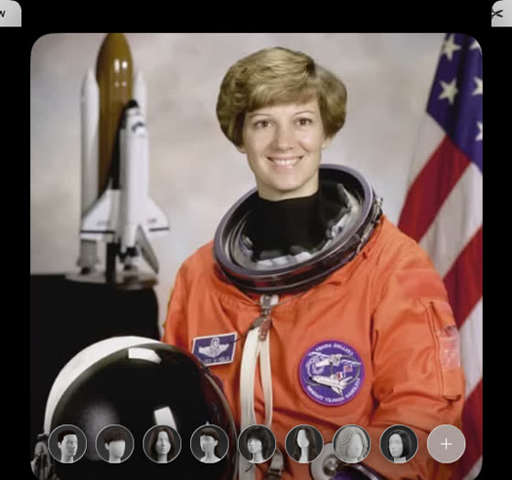
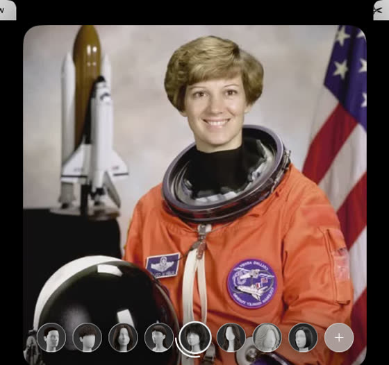
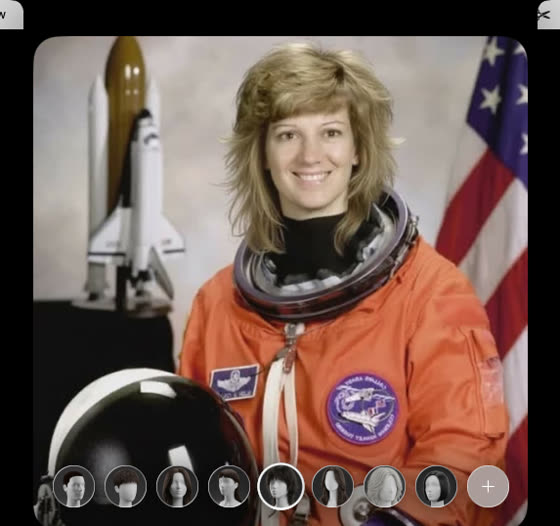
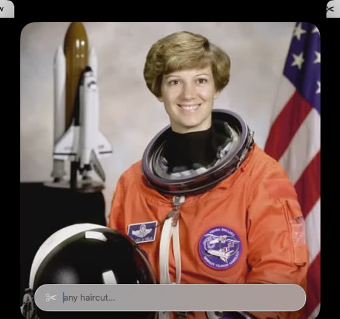

# Mane

A mirror that drops out of your MacBook's notch and lets you try haircuts on, live.

Click the notch → a square mirror grows out of it → tap a circle → you, with that haircut.
No text, no buttons: just you and a row of floating circles. **+** lets you type any haircut.

<p align="center"></p>

| Open | Choosing | Wolf cut | + |
| --- | --- | --- | --- |
|  |  |  |  |

*The real app on macOS 26, screenshotted by CI in demo mode (a test photo stands in for the
camera, and the wolf cut is the photo-fallback result).*

## Install

1. Download **Mane.dmg** from the [`mane-latest` release](https://github.com/junkurera13/jun-work/releases/tag/mane-latest).
2. Open it and drag **Mane** into **Applications**.
3. The first time only: **right-click Mane → Open → Open**. (It isn't signed with a paid Apple
   developer account, so macOS asks once.) If macOS still refuses, go to
   **System Settings → Privacy & Security** and click **Open Anyway**.
4. A small window asks for your **fal.ai key** — paste it and press Save
   (keys: [fal.ai/dashboard/keys](https://fal.ai/dashboard/keys)). You can change it later from the
   ✂︎ in the menu bar.
5. Allow the camera when macOS asks.

Needs macOS 14 (Sonoma) or newer. Works on Macs without a notch too (a small black pill
appears at the top centre of the screen).

## Use

| | |
| --- | --- |
| **Click the notch** (or **⌃⌥M**) | Open the mirror |
| **Tap a circle** | Try that haircut (tap it again for your real hair) |
| **+** | Type any haircut (e.g. "pink mohawk", "slicked-back undercut"), press Return |
| **Press and hold the mirror** | Peek at your real hair |
| **⌘S** | Save what's in the mirror to `~/Pictures/Mane` |
| **Esc**, or click anywhere else | Close (the camera turns off) |

The circles start as little porcelain heads. After you try a cut, its circle shows *your*
face with that cut.

## How it works

- **Live video:** your camera streams to **Eden Live** (VAST's real-time video model, on fal.ai),
  which re-renders the video in the look of an *anchor*: one frame of you already wearing the cut.
  You move, blink and talk; the video follows you with the new hair, at 1280×704, 24 fps.
- **Anchors:** when you tap a cut, Mane grabs a camera frame and asks **Nano Banana** (Google's
  image editor, on fal.ai) for you with that cut (~9 s). Meanwhile the live session is already
  opening. After the first cut, the other cuts' anchors are made in the background, so later taps
  switch in about two seconds, and the circles turn into your face with each cut.
- **Backup engine:** if Eden can't start, Mane tries **Decart Lucy 2.6** (also on fal.ai), which
  edits the video directly. (Lucy's shared capacity on fal was full when this was built.)
- No photos: if no live engine starts, the circle shakes and you stay on your real reflection.
- The native app (Swift) is the notch window, circles, menu bar and shortcut; the mirror itself is a
  small web page (`web/mirror.html`) inside a WebKit view, which already knows how to do camera +
  WebRTC. fal's official realtime client is bundled (`web/vendor/fal-realtime.js`, pinned); its
  requests go through the app, which adds your key, so the key never enters the web page.

More detail and the reasoning: [`docs/design.md`](docs/design.md).

## Cost (your fal.ai account)

- Live (Eden Live 5B): about **$0.0035 per second** while a cut is showing (≈ 21¢ a minute),
  10 seconds minimum per session.
- Anchors (Nano Banana): about **4¢ each**. The first tap makes one; the other seven built-in cuts
  are then made in the background (≈ 30¢ per opening of the mirror).
- Mane hangs up 12 s after you go back to your real hair, after 3 minutes without a tap, and
  whenever the mirror closes.

## Troubleshooting

- **The mirror is black with a crossed-out camera:** camera access is off. Click the symbol
  (opens System Settings → Privacy & Security → Camera) and turn Mane on.
- **Circles shake and nothing happens / the key window pops up:** the key is wrong, the fal
  account is out of credit, or no live engine could start (fal had no capacity).
- **The very first cut of the day takes long:** fal may be starting a machine for Eden (we saw
  up to ~45 s once); after that, sessions start in a few seconds.
- Logs: `log stream --predicate 'process == "Mane"'` in Terminal.

## Build it yourself

```sh
cd mane
scripts/bundle.sh          # needs Xcode 16+; makes build/Mane.app, Mane.dmg, Mane.zip
open build/Mane.app
```

Every push touching `mane/` builds it on a GitHub Mac (`.github/workflows/mane.yml`), draws the
UI, runs a WebKit probe, takes screenshots in demo mode, and republishes the `mane-latest` release.

Test the live pipeline without a Mac (headless Chromium + a fake camera), doing exactly what the
app does:

```sh
FAL_KEY=... node tools/try-live.mjs --app-flow --engines eden --video face.mjpeg --out shots --record \
  --style "buzz=a very short buzz cut" --style "wolf=a shaggy wolf cut"
```

On GitHub, a commit whose message contains `[live]` runs that test on a machine with open
internet and publishes the frames as the `mane-live-test` release. It uses the `FAL_KEY` secret if
the repo has one; otherwise it waits for the key encrypted to a one-time public key (see the
workflow).

## Moving it to its own repo

Everything is in `mane/` except the build recipe. Copy `mane/` to the new repo's root and
`.github/workflows/mane.yml` alongside it, then in the workflow remove
`defaults.run.working-directory` and the `mane/` prefixes in the artifact paths.

## Files

```
mane/
├── App/                 Swift: notch window, mirror engine, circles, menu bar, fal calls
├── web/mirror.html      the mirror: camera, Lucy live session (WebRTC), stills
├── Resources/           Info.plist, app icon, circle pictures
├── scripts/bundle.sh    builds the .app / .dmg
├── tools/               live-pipeline test harness + screenshot fixtures
└── docs/design.md       why it's built this way
```
